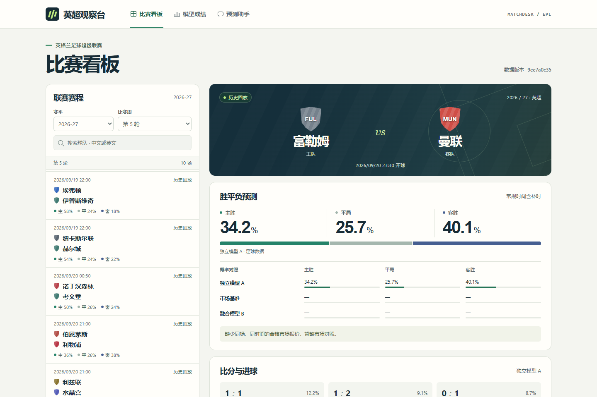

# EPL Matchdesk

[简体中文](README.md) · [Data provenance](docs/DATA.md) · [Model card](docs/MODEL.md) · [Evaluation protocol](docs/EVALUATION.md)

Explore English Premier League match predictions one day before kickoff. The Chinese-language dashboard compares an independent football model, a de-vigged market consensus and an 80/20 market/football blend. The local assistant answers questions using the selected match and the same probability snapshot.



## Run locally

From a clone or source archive, using Python 3.11–3.13:

```sh
python -m pip install -c requirements.lock .
python -m epl_agent demo
```

Open [Matchdesk](http://127.0.0.1:5051). Pick a season and matchweek, search a club and select a fixture. Predictions and results are displayed separately. The static frontend, CC0 data and fitted models ship with the package; no provider account or Node installation is required.

## Reproduce the research

```sh
python -m epl_agent predict 2026-27_fulham_manchester-united
python -m epl_agent backtest --recompute --output scores.json
python -m epl_agent backtest --formal
python -m epl_agent export site
```

The release contains 9,880 results across 26 complete seasons plus a pinned partial 2026/27 season. Two warm-up seasons leave 9,170 historical reconstructions. The formal leaderboard counts only prospectively paired, witnessed forecasts. Market superiority is an empirical target.

Use `sync` to observe new schedules, `train` to activate a local build, and `worker` for ongoing capture. Set `EPL_AGENT_HOME` for local storage and `ODDS_API_KEY` for optional live UK 1X2 odds. A maintainer can publish time evidence to a dedicated public GitHub issue, as described in the protocol. Raw odds and keys stay local. To host the static replay, select GitHub Actions as the Pages source and run **Publish replay dashboard**.
