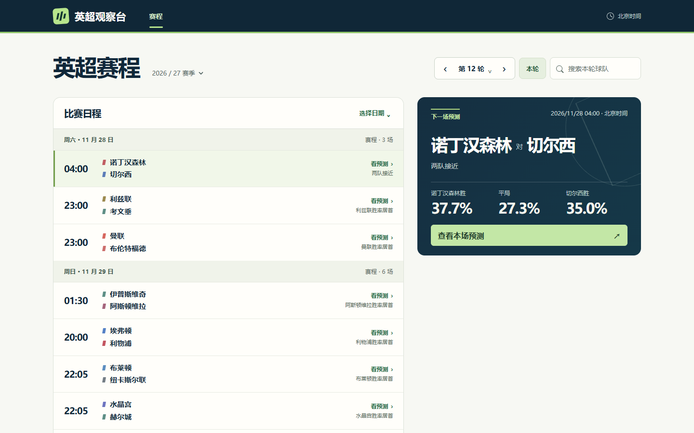

# 英超观察台 · EPL Prediction Agent

[English](README.en.md) · [数据来源](docs/DATA.md) · [模型卡](docs/MODEL.md) · [市场验证协议](docs/EVALUATION.md)

**免登录看本轮英超，点开比赛看预测，赛后看确认比分。** [打开在线比赛看板](https://lanthonyj.github.io/worldcup_prediction/)

| 你想做什么 | 可以这样试 |
|---|---|
| 看懂一场预测 | 2026 年 11 月 26 日的森林对切尔西赛前预览给出森林胜 37.7%、平局 27.3%、切尔西胜 35.0%。当时最可能的单一比分是 1–1（约 13.0%）。[打开这场比赛](https://lanthonyj.github.io/worldcup_prediction/#/match/2026-27_nottingham-forest_chelsea) · [固定批次验收](docs/FAN-RELEASE-2026-11-26.md) |
| 留在原页追问 | 在“问这场”输入“阿森纳下一场踢谁”，再问“那场几点开球”。回答会标出对阵、数据截止和依据。说“本页这场”即可回到原对阵。也可以查最近五场英超、上次交锋和按已确认比分计算的积分榜。 |
| 核对完场结果 | 在赛程行或分享链接查看确认比分，通过“本场数据来源与方法”核对记录。[布莱顿 2–0 布伦特福德](https://lanthonyj.github.io/worldcup_prediction/#/match/2026-27_brighton-hove-albion_brentford) |

公开看板使用设备当地时间。主胜、平局、客胜指常规时间含补时。赛前预览会随数据更新，正式预测以开球前 24 小时的冻结记录为准。免密钥问答直接引用可核验的比赛资料；伤停、首发或球员进球概率缺少依据时，会说明具体缺项。



## 本地运行

准备 Git 和 Python 3.11–3.13。发布包自带前端、模型及 26 个完整赛季的 9,880 场比分。安装依赖后，可离线体验，无需 Node、账号或 API 密钥。英超项目位于该仓库的 `epl-v1` 分支。

```sh
git clone -b epl-v1 --single-branch https://github.com/LAnthonyJ/worldcup_prediction.git epl-prediction-agent
cd epl-prediction-agent
```

**Windows PowerShell**

```powershell
python -m venv .venv
.\.venv\Scripts\python.exe -m pip install -c requirements.lock .
.\.venv\Scripts\python.exe -m epl_agent demo
```

**macOS 或 Linux**

```sh
python3 -m venv .venv
.venv/bin/python -m pip install -c requirements.lock .
.venv/bin/python -m epl_agent demo
```

打开[本地比赛看板](http://127.0.0.1:5051)。全新离线安装可以直接看历史比分；包内 2026/27 赛季第 12 轮的 10 场开球时间均待核实。想马上试赛前分析，可以打开上面的森林对切尔西示例。比赛取得至少三家合格书商的完整同期报价后，也可展示市场概率与融合预测。

要同步赛程和比分，在另一个终端进入同一目录。Windows 运行 `.\.venv\Scripts\python.exe -m epl_agent sync`，macOS 或 Linux 运行 `.venv/bin/python -m epl_agent sync`，完成后刷新看板。下列命令中的 `python` 均指这个虚拟环境的解释器。

[手机赛程](docs/screenshots/matchdesk-mobile.png) · [赛前详情](docs/screenshots/match-preview-mobile.png) · [完场比分](docs/screenshots/match-result-mobile.png)

## 核对一场比赛的全流程

当前软件版本为 **1.0.0rc1**。2026 年 11 月 26 日验收中，同一组 48 道问题在 Flask、静态网页和模拟生产网关得到 144 个正确答案。公网匿名复算也核对了整轮 10 场的开球时间、预测状态和显示概率。生产 DeepSeek 调用与真实市场配对另行验收。达到实赛条件后，成绩页会列出可核验样本和评分。[验收记录](docs/FAN-RELEASE-2026-11-26.md) · [自动化测试](https://github.com/LAnthonyJ/worldcup_prediction/actions/runs/45788121445) · [公开成绩](https://lanthonyj.github.io/worldcup_prediction/#/report) · [AI 服务配置](docs/ANALYSIS.md)

研究成绩页和下列命令可核对赛程版本、实际冻结、公开见证和赛后结算。模型 A 的前瞻成绩包括按时见证并通过审核的独立预测；同期报价足够的比赛还进入市场与模型 B 的配对成绩。真实比赛链接以成绩页的已核验记录为准。

```sh
python -m epl_agent status
python -m epl_agent match trace 2026-27_fulham_manchester-united
```

Windows 维护者可用任务计划程序在开机后自动运行采集。部署入口、备份及回滚步骤见[采集运维与两步验收](docs/EVALUATION.md#采集运维与两步验收)。

## 用同一份数据复现

```sh
python -m epl_agent predict 2026-27_fulham_manchester-united
python -m epl_agent ask "这场为什么更看好客队" --fixture 2026-27_fulham_manchester-united
python -m epl_agent backtest --recompute --output scores.json
python -m epl_agent backtest --formal
```

历史评估采用逐赛季向前训练。最初两个赛季用于积累历史，打包快照另含 2026/27 赛季已记录的 50 场结果，总计 **9,170 场历史重建**。历史统计与前瞻市场对照在成绩页中分别展示。数据版本固定，当前赛程的新鲜度取决于上游更新。

| 命令 | 用途 |
|---|---|
| `python -m epl_agent sync` | 免费同步当季开放赛程，保留观察时间与改期版本 |
| `python -m epl_agent train` | 重新训练独立模型，生成回放和评分，将完整版本设为本地活动模型 |
| `python -m epl_agent register` | 在本机冻结正式评测协议和模型版本 |
| `python -m epl_agent worker` | 前台运行采集服务，两家赛程源各约每小时同步一次，正常运行时约每 20 秒检查冻结窗口 |
| `python -m epl_agent ledger` | 输出可公开的预测、时间证据和缺项原因 |
| `python -m epl_agent snapshot export public-export` | 输出带校验值、赛程分母和修订的公开数据包 |
| `python -m epl_agent snapshot verify public-export` | 按同一报告时点复算，核对独立指定的见证 issue |
| `python -m epl_agent export site` | 导出可在静态服务器运行的交互历史版 |

本地设置、模型和原始盘口默认写入用户主目录的 `.epl-prediction-agent`，可通过 `EPL_AGENT_HOME` 切换。采集赔率需要将个人免费密钥设为 `ODDS_API_KEY`。历史训练和回放全程可离线。官方比较的公开时间见证需由仓库维护者单独开启，详见[操作与评测说明](docs/EVALUATION.md)。

## GitHub Pages

公开站从 `epl-v1` 构建，每次发布固定到 `public-data` 的一个提交。线上批次标记提供完整提交号；用它可在数据分支找到该次的 `snapshot.json`，并在见证账本核对赛前摘要。维护者在采集机运行 `python -m epl_agent worker --publish --publish-snapshot`。原始书商报价保存在本地。[当前线上批次标记](https://lanthonyj.github.io/worldcup_prediction/public-data-commit.txt) · [公开数据分支](https://github.com/LAnthonyJ/worldcup_prediction/tree/public-data) · [赛前见证账本](https://github.com/LAnthonyJ/worldcup_prediction/issues/1) · [维护步骤](docs/EVALUATION.md)

历史比分来自 openfootball（CC0）。当季合并数据库注明 OpenLigaDB 并按 ODbL 1.0 提供，可在已核验数据包部署的站点下载[当季合并数据库](https://lanthonyj.github.io/worldcup_prediction/merged-seasons.json)。[OpenLigaDB 许可](https://www.openligadb.de/en/license)
